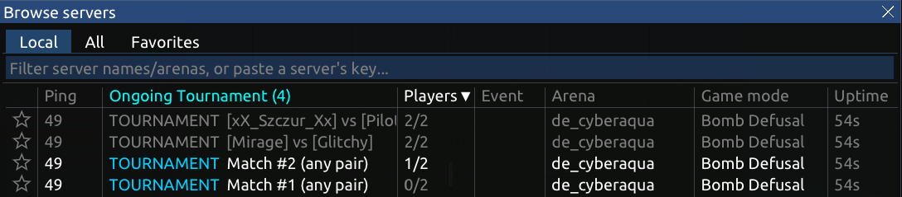

# Host a Hypersomnia server

**[Use the config generator](https://hypersomnia.io/generator)** - it writes everything for your setup: the config, the commands, the ports to open. This page is the reference for when something doesn't work, and for what the generator doesn't cover.

- [Troubleshooting](#troubleshooting)
- [Ports](#ports)
- [Config files](#config-files)
- [Environment variables](#environment-variables)
- [Admins](#admins)
- [Tournaments](#tournaments)
- [Match results](#match-results)
- [Several servers, ranked](#several-servers-ranked)
- [The server key](#the-server-key)
- [Command line flags](#command-line-flags)

# Troubleshooting

**The server isn't on the [server list](https://hypersomnia.io/servers).**
Look in the log for errors. The server must reach `masterserver.hypersomnia.io` (outgoing UDP `8430`); `notified_server_list` must not be changed in the config.

**It's on the list, but nobody can join.**
The UDP ports are closed - open them in the system's firewall and in the cloud provider's panel (AWS, Hetzner, OVH...). Browser players need `9000` too.

**Players with the new version can't join.**
The server is outdated. It updates on every start and every day at 03:00 (`--daily-autoupdate`; Docker by default) - restart it to update right away.

**I changed `conf.d/`, nothing changed.**
The setting was changed from the panel before - see [the order](#the-order).

**Docker: `Permission denied` in the log.**
The data folder must belong to the user `999`: `sudo chown -R 999:999 /opt/hypersomnia`.

**AppImage: `fuse: failed to exec fusermount` / `Cannot mount AppImage`.**
Add `--appimage-extract-and-run`, or install `fuse` (`fuse2` on Arch).

**Where are the logs?**
On the standard output (`docker compose logs`, `journalctl --user -u hypersomnia`) and in `logs/` next to `user/`. A server that started fine logs its name and key:

```
Server name: My server
Server key: 3f9a2c... (.../.keys/server.key)
```

Still stuck? Ask on [Discord](https://discord.gg/YC49E4G).

# Ports

| Port | Protocol | For |
|---|---|---|
| `8412` | UDP | Players of the game (Steam, Windows, Linux, macOS) |
| `9000` | UDP | Players in the browser ([play.hypersomnia.io](https://play.hypersomnia.io)) |
| `8430` (outgoing) | UDP | The server list - usually allowed already |
| `8412` | TCP | A tournament's [live results page](#tournaments) |

Several servers take the next ports: `8412-8414`, `9000-9002` for three.

# Config files

The user folder: `~/.config/Hypersomnia/user/` (AppImage), `/opt/hypersomnia/user/` (AppImage as a separate user), `/opt/hypersomnia/` (Docker).

- `conf.d/*.json` - your config, in alphabetical order. The server never changes them.
- `conf.d/private.json` - `server_private`: the password, admins, the spectator account, the listed accounts, the Discord and tournament results webhooks. Kept apart so the rest can be shown to others; `chmod 600`. Docker compose keeps the password and both webhooks in a `.env` next to `compose.yaml` instead.
- `runtime_prefs.json` - what was changed from the administration panel.
- `server_bans.json` - the bans.

All settings, with comments: [`default_config.json`](https://github.com/TeamHypersomnia/Hypersomnia/blob/master/hypersomnia/default_config.json). The sections for a server: `server_start` (port, slots), `server` (name, arenas, map cycle, bots, rules, updates), `server_private` (never sent to players), `instances` (how many servers).

An arena is `"name"` (its default game mode) or `"name game_mode"`, e.g. `"fy_iceworld bomb_defusal"`. Community arenas ([hypersomnia.io/arenas](https://hypersomnia.io/arenas)) are downloaded the first time they're needed.

### The order

Later ones win:

1. `default_config.json` - comes with the game.
2. `conf.d/*.json`.
3. `HYPERSOMNIA_CONFIG`, then the other [environment variables](#environment-variables).
4. `runtime_prefs.json` - **the panel's changes override the files on every start.** Changed a file and nothing happened? Remove the setting from `runtime_prefs.json` (or reset it in the panel) and restart.
5. `--apply-config <file>`.

# Environment variables

| Variable | What it sets | Example |
|---|---|---|
| `HYPERSOMNIA_SERVER_NAME` | The name on the server list | `My server` |
| `HYPERSOMNIA_ARENA` | The first arena | `fy_iceworld bomb_defusal` |
| `HYPERSOMNIA_MAP_CYCLE` | The arenas that follow each other | `de_silo,de_metro` |
| `HYPERSOMNIA_MAP_CYCLE_RANDOM` | `off`: the cycle in its order, not shuffled | `off` |
| `HYPERSOMNIA_ADMINS` | [Admins](#admins) with full rights | `steam_7656119...,0x8aed41f2...` |
| `HYPERSOMNIA_PASSWORD` | Only players who know it can join | |
| `HYPERSOMNIA_ALLOWED_ACCOUNTS` | Only these accounts get in, and the [admins](#admins) | `steam_7656119...,0x8aed41f2...` |
| `HYPERSOMNIA_SPECTATOR` | The [spectator account](#watching-a-match): always gets in, only to watch | `steam_7656119...` |
| `HYPERSOMNIA_SLOTS` | Players per server, at most `57` | `10` |
| `HYPERSOMNIA_SERVER_INSTANCES` | How many servers | `3` |
| `HYPERSOMNIA_PORT`, `HYPERSOMNIA_WEB_PORT` | The first server's ports | `8500` |
| `HYPERSOMNIA_BROWSER_PLAYERS` | `off`: no browser players, no browser ports | `off` |
| `HYPERSOMNIA_SERVER_LIST` | `off`: not on the [server list](https://hypersomnia.io/servers) - browser players can't join; or the address of your own masterserver | `off` |
| `HYPERSOMNIA_TOURNAMENT_SPECTATORS` | How many others may watch each tournament match (6 by default) - every place takes about 4.4 MB of RAM up front | `10` |
| `HYPERSOMNIA_BOT_QUOTA` | How many bots, `0` for none - the arena's own number when not set | `6` |
| `HYPERSOMNIA_BOT_DIFFICULTY` | `VERY_EASY`, `EASY`, `MEDIUM`, `HARD` or `PROGRESSIVE` (the default) | `HARD` |
| `HYPERSOMNIA_DAILY_UPDATE` | When to update every day, or `off` | `05:00` |
| `HYPERSOMNIA_TIME_ZONE` | Where the server is - happy hours follow it | `Europe/Berlin` |
| `HYPERSOMNIA_DISCORD_WEBHOOK` | Posts joins and match results to your Discord | |
| `HYPERSOMNIA_TOURNAMENT` | A [tournament](#tournaments) for this many players | `16` |
| `HYPERSOMNIA_TOURNAMENT_TEAM_SIZE` | `2` for 2v2 and so on | `2` |
| `HYPERSOMNIA_TOURNAMENT_TEAMS` | Teams set up beforehand: a player per line, the teams apart by an empty line (1v1: a player per line) - or a team per line, `;` between the teams, `,` between the players. `=<account id>` to verify them | `alice=0x8aed..., bob=steam_7656...; carol=..., dave=...` |
| `HYPERSOMNIA_TOURNAMENT_ARENAS` | An arena per bracket round, the final last - apart by `,` or lines | `de_cyberaqua,de_silo` |
| `HYPERSOMNIA_TOURNAMENT_JOIN_TIMEOUT` | Minutes a match waits for its players, or `off` (10 by default) | `5` |
| `HYPERSOMNIA_TOURNAMENT_PAGE` | The [live results page](#tournaments)'s TCP port, or `off` | `8080` |
| `HYPERSOMNIA_TOURNAMENT_NAME` | On the live results page and in the results | `onFOSS November Cup 2026` |
| `HYPERSOMNIA_TOURNAMENT_RESULTS_WEBHOOK` | Gets the [results](#the-results-as-json) in one `POST` when the tournament is over | `https://example.com/results` |
| `HYPERSOMNIA_CONFIG` | Anything else - JSON, like a file in `conf.d/` | |
| `HYPERSOMNIA_SERVER_PRIVATE_KEY` | The [server key](#the-server-key), instead of the file | |

# Admins

An admin is an account: in the game, `Settings → Account → Copy account id`. `steam_...` in the Steam version, `0x...` elsewhere (a key linked to Steam is its own `0x...` account - add both). Join the server and press `Esc` for the administration panel.

The generator makes full admins. Others go into `admin_profiles` by hand, e.g. `{ "account": "0x8aed41f2...", "rcon": "RCON", "badge": "MOD" }`:

| `rcon` | Can |
|---|---|
| `MASTER_RCON` | Everything |
| `RCON` | Kick, ban, the arena, the game mode and the map cycle - not the server's settings |
| `NONE` | Nothing - only the badge |

Every admin, whatever their `rcon`, always gets in: without the password, past the per-network limit of ranked servers, and into a full server (2 places are kept for admins, not shown on the server list). Before a ranked match or a tournament's match starts, an admin plays as anyone; once it's played, only [watches](#watching-a-match).

`Timeout absent players` (administration panel, `Maintenance`) decides a tournament's match now: the team with more players present wins - equal numbers play as they are - nobody there: both teams are out.

## Watching a match

Who comes into a ranked match or a tournament's match while it's played - only as a spectator, and back whenever they like:

- whoever was a spectator when it started;
- the admins;
- **the spectator account** - one account for a caster or a bot streaming the matches: `"spectator_account": "steam_7656..."` in `server_private` (`HYPERSOMNIA_SPECTATOR`). It always gets in - no password, a place kept for it on a full server - and is never on a team. In a tournament: into every match;
- in a tournament: a team whose own match in this round is decided (won, lost, or a bye) watches the others. With anyone joining round 1: once their own match there is decided.

Spectators are quiet: nobody's told they came or left, and what they write in the chat only spectators read. They read all of it - the teams' chat too.

**A clan's server:** `"allowed_accounts": ["steam_7656...", "0x8aed..."]` in `server_private` (`HYPERSOMNIA_ALLOWED_ACCOUNTS`) - only these accounts get in, and the admins. The server lists show it with a padlock; nobody's asked for a password - whoever isn't listed is refused on joining.

# Tournaments



A knockout tournament: a server for every match, the winners go on round by round.

**The live results page** - the bracket with every match's score as it's played - is served by the server itself at `http://<your server>:8412/` (TCP, the first game port's number by default - `--tournament-page <port>` for another), and linked from the [server list](https://hypersomnia.io/servers). Its data: [`/tournament.json`](#the-results-as-json). A port below `1024` needs root; a port taken by something else: the tournament goes on without the page. `--tournament-name "onFOSS November Cup 2026"` titles it - without a name: `My Tournament`.

- Open first round: a `Match #N (any pair)` server per pair of the bracket (16 players 1v1: 8; at least two teams' worth of players); players join any of them, the first ones there make the match - named by them once full, e.g. `[alice] vs [bob]`.
- Listed teams: lines 1 and 2 play each other, 3 and 4... Teams short of 2, 4, 8, 16...: the first lines advance without playing. Any number of them from one address (a LAN party behind one router) - with anyone joining, at most `max_ranked_players_per_ip` (2), as in ranked.
  - **Listed nicknames** (`alice, bob; carol, dave`): the first one to come with a listed nickname takes it - from then on that player is their account (the game's key), the nickname is only a label, and anyone else with it is told it's taken. Enough for a LAN: whoever comes first as `alice` is alice, and a player who changes computers mid-tournament doesn't get back in.
  - **Listed accounts** (`alice=0x8aed..., bob=steam_7656...; ...`): let in by their account (`Settings → Account → Copy account id` in the game), shown by the nickname written here - they play under any name. Every player needs one; a list with one missing doesn't start.
- Once all the players it's for came, round 1 closes by itself: whoever waits alone advances without playing, the empty servers close. Fewer came? `Close round 1` (administration panel, `Maintenance`) does the same - or the join timeout.
- One place per account in round 1: a player with a place on one server who joins another is sent back to theirs. And one player per nickname: whoever comes with a nickname another player took (say, two who didn't set theirs) is told to change it.
- **Join timeout** (10 minutes by default, `--tournament-join-timeout <minutes>` or `off`): a match still waiting for its players that long after the round's first player came (to any of its matches) is decided without them - so a tournament started long before the players come waits for them - the team with more players present wins by walkover, equal numbers play as they are, nobody came - both teams are out (in the final: the tournament ends without a winner). Round 1 with anyone joining: closes as `Close round 1` does. Matches being played aren't touched.
- Byes fill the bracket up to 2, 4, 8... once - from round 2, counted from the teams that are left. They go to the strongest: the first lines, then by how fast they won; a walkover counts as the weakest. The final is always on the last arena.
- Admins join any match: before it starts as anyone (a player in round 1 with anyone joining), once it's played as spectators.
- The teams that are out or waiting watch the other matches - at most 6 others at once on each (`--tournament-spectators`): every place takes about 4.4 MB of RAM up front and upload while watched. A match's players always get in, the admins and the spectator account too.
- A tournament doesn't start with anything in its config it can't read as written - a misspelled key, text where a number goes, an arena or a game mode that doesn't exist. Other servers only warn.
- After a crash, start it again with the same settings - it carries on mid-round. Once over, the same settings under the same name don't start it again - give the next one a new `--tournament-name`; the finished one's state in `tournament.completed.<time>.state.json`. The name is part of what the tournament is: started again under another name after a crash, it begins anew.
- It never updates in the middle of it.
- On a LAN everyone sees the matches together under `Ongoing Tournament`; on the public list only official servers' tournaments show so.

## The results as JSON

`http://<your server>:8412/tournament.json` while it's played (at most 5 requests a second from one address, made anew once a second), and one `POST` of the same to `server_private.tournament_results_webhook_url` (`HYPERSOMNIA_TOURNAMENT_RESULTS_WEBHOOK`) when it's over - tried 3 times until answered with a `2xx`, and again every time the server is started after that. The very same JSON is saved to `tournament_results.json` in the user folder. The receiver takes only `"state": "FINISHED"` and drops a copy it already has (the same `name` and `winner_team`). `Show example payload` in the config generator shows a whole one.

Both are signed by the server's key: `X-Hypersomnia-Server-Key` - its public key (what `--print-server-key` prints), `X-Hypersomnia-Signature` - Ed25519 of the body, in hex. Check that the key is your server's and the signature is right, and nobody could have made up the results.

- `name` - `My Tournament` without `--tournament-name`; `state` - `ONGOING` or `FINISHED`; `winner_team` - its players, empty until it's over.
- `rounds` - the final first: `name`, `state` (`PLAYED`, `PLAYING`, `COMING`), `arena`, `matches`, `byes` (the teams that went on without playing).
- A match: `status` (`done`, `walkover`, `live`, `waiting`, `empty` - nobody came, `coming` - its teams not known yet), `winner` (`a` or `b` once decided, otherwise empty), `team_a`, `team_b` (in a played round the winner is `team_a`); `score_a`, `score_b` while it's played and after - none for a walkover; `server_name`, `port` while it's waited for or played. A match nobody came to is listed only while its round is played.
- A player: `nickname` and `account` - empty for a listed nickname nobody has come with yet.
- `config` - `who_gets_in` (`anyone`, `listed nicknames`, `listed accounts`), `team_size`, `teams`, `arenas`, `join_timeout_minutes` (`0`: off).

# Match results

- **Discord or Telegram:** `Discord webhook` in the config generator (`server_private.discord_webhook_url`; for Telegram `telegram_webhook_url` and `telegram_channel_id`) - who joined, duels, every match's result. More of them, e.g. filtered by a clan: `custom_webhook_urls`.
- **A tournament:** its [live results page](#tournaments), the [results webhook](#the-results-as-json), `tournament_results.json` in the user folder (the same JSON); its whole state in `tournament.completed.<time>.state.json`.
- **MMR:** every ranked and tournament match is reported to hypersomnia.io, signed by the [server key](#the-server-key) - it counts only from an official server. Not official, the report is sent once and kept in `user/unsent_reports/` (`<name>.json` and its `<name>.headers`): send both to us with your key (`--print-server-key`) and we can count it later.
- **Anything else:** every match's start and end as a `SERVER_EVENT` line with JSON in the log - each player's nickname and account id, and the rest in [`default_config.json`](https://github.com/TeamHypersomnia/Hypersomnia/blob/master/hypersomnia/default_config.json).

# Several servers, ranked

`"instances": { "casual": 1, "ranked": 2 }` - one process, consecutive ports, named `My server #1`, `#2`... (`c1`, `r1`, `r2` on the list). Restarting one restarts all.

- A ranked match starts when the warmup ends or all type `/go`, and freezes while someone is missing. It counts on the [leaderboards](https://hypersomnia.io/leaderboards/bomb-defusal) only on official servers.
- Ranked takes only signed-in players, at most 2 per IP (`max_ranked_players_per_ip`); keep the clock right (`chrony` / `systemd-timesyncd`) or sign-ins fail.
- Settings for ranked only: `"instance_vars": { "ranked": { ... } }`.
- Panel changes on `c1` apply to all, on `r1` to the ranked ones, elsewhere until the next restart.

# The server key

`.keys/server.key` in the user folder, made on the first start. Players know your server by it.

> [!WARNING]
> **Back it up and keep it secret.** Without it a reinstalled server is a new server to the players; with it anyone can pose as yours.

- Print the public key: `--print-server-key`. All servers of one machine share it.
- Not on the server list? `--print-join-string` prints the line to publish: `203.0.113.7,My server,0x8aed...` (your public address as the server list sees it, your server's name, its key). Players who copy it get your server added to their favorites as soon as the game's main menu comes back into focus.
- Moving the server to another machine: put the old `server.key` in place before the first start (`Server key` in the config generator's advanced options does it for you, from a file).
- Docker keeps it on the volume (`/opt/hypersomnia/.keys/server.key`). Without a volume every new container is a new server - mount the key file, or pass it from your hosting platform's secret store in `HYPERSOMNIA_SERVER_PRIVATE_KEY` (never written in `compose.yaml`: an environment variable shows in `docker inspect`).
- **Official servers**: send us the output of `--print-server-key` on [Discord](https://discord.gg/YC49E4G).

# Command line flags

| Flag | What it does |
|---|---|
| `--daily-autoupdate` | Update every day at 03:00 if there's a new version |
| `--as-service` | For systemd: exit on restart, systemd starts it again |
| `--appdata-dir <dir>` | Keep `user/`, `logs/`, `cache/` in `<dir>` |
| `--apply-config <file>` | One more config file, applied last |
| `--tournament <players>` | A [tournament](#tournaments) for this many players |
| `--tournament-team-size <n>` | `2` for 2v2 and so on |
| `--tournament-teams <teams>` | Teams set up beforehand, e.g. `"alice, bob; carol, dave"`, or verified by their accounts: `"alice=0x8aed..., bob=steam_7656...; ..."` - or a player per line, the teams apart by an empty line |
| `--tournament-spectators <places>` | How many others may watch each match at once, 6 by default (`HYPERSOMNIA_TOURNAMENT_SPECTATORS`) |
| `--tournament-arenas <arenas>` | An arena per bracket round, e.g. `de_cyberaqua,de_silo` - or one per line |
| `--tournament-join-timeout <minutes>` | How long a match waits for its players (10 by default), or `off` |
| `--tournament-page <port>` | The [live results page](#tournaments)'s TCP port (the first game port's number by default), or `off` |
| `--tournament-name <name>` | On the live results page and in the results, e.g. `"onFOSS November Cup 2026"` |
| `--print-server-key` | Print the server's public key and quit |
| `--print-join-string` | Print `<address>,<name>,0x<key>` - the line players copy to add your server to their favorites - and quit |
| `--sync-external-arenas-and-quit` | Download all community arenas and quit |
